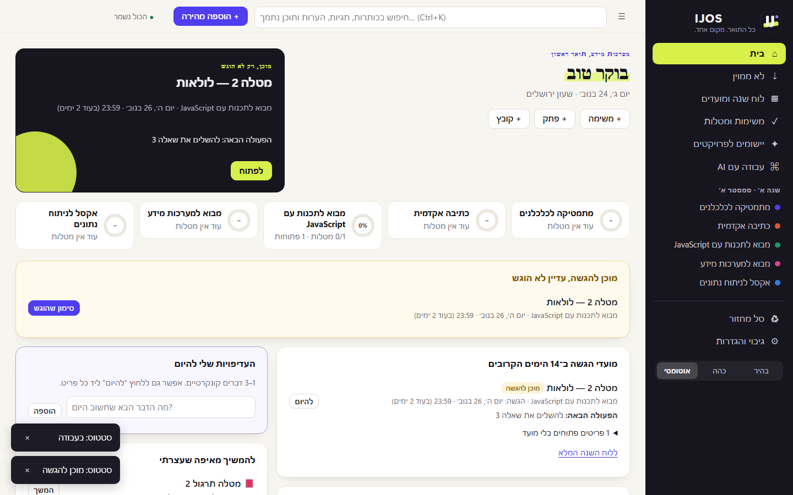
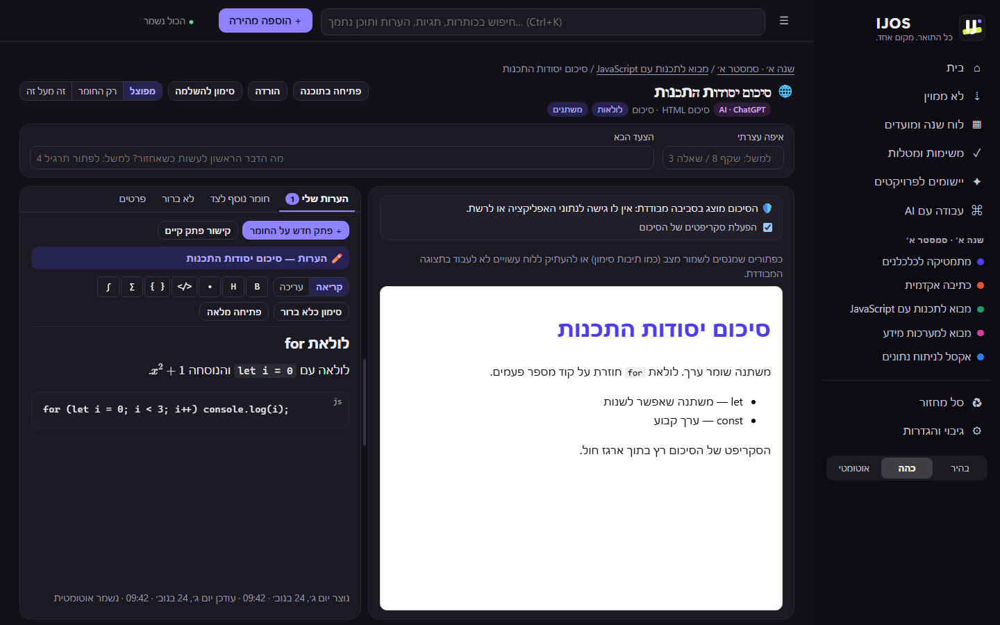
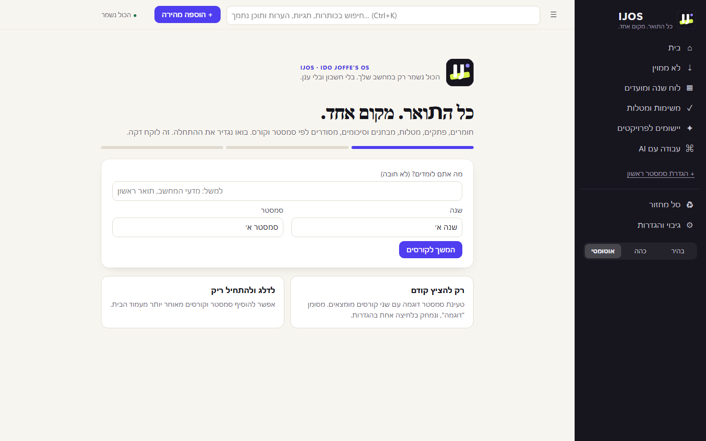
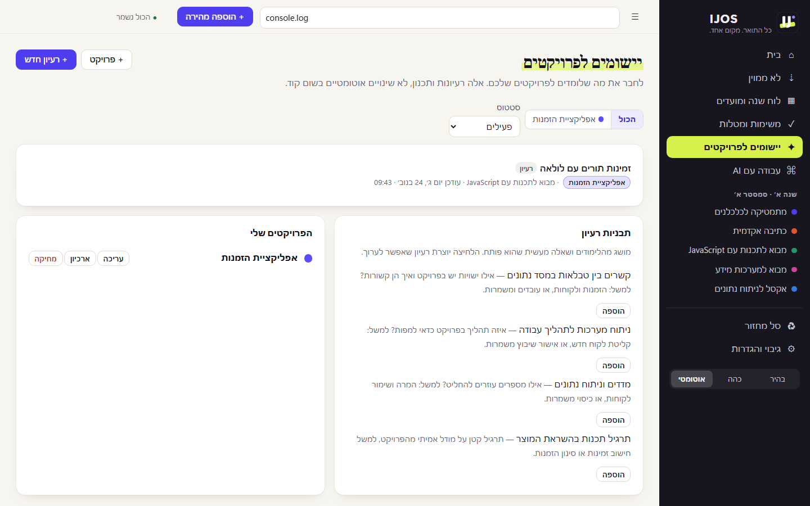

<div dir="rtl">

<p align="center"></p>

# IJOS · Ido Joffe's OS

### כל התואר. מקום אחד.

IJOS היא סביבת לימוד אישית לסטודנטים. כל מה שיש לכם בתואר נמצא בה במקום אחד: חומרים, פתקים, מטלות, מבחנים, סיכומים ורעיונות לפרויקטים. היא רצה **על המחשב שלכם בלבד** ונפתחת בדפדפן. אין הרשמה, אין ענן ואין מנוי.

בניתי את IJOS לעצמי, לתואר במנהל עסקים עם התמחות במערכות מידע, והפכתי אותה לכלי שכל סטודנט יכול להוריד ולהשתמש בו. הממשק בעברית ומימין לשמאל, עם תמיכה מלאה באנגלית, בקוד ובנוסחאות.

<p align="center"></p>

> כל צילומי המסך במסמך הזה נוצרו עם נתונים סינתטיים (קורסים וקבצים מומצאים).

## למי זה מתאים

- סטודנטים שהחומרים שלהם מפוזרים בין Moodle, תיקיות במחשב, WhatsApp וצ'אטים עם AI.
- מי שרוצה לדעת בכל רגע מה מוגש מתי, מה כבר מוכן ומה באמת הוגש.
- מי שכותב סיכומים ורוצה לבנות לאורך הסמסטר "סיכום מרכזי" אחד לכל קורס.
- מי שעובד על פרויקט אישי ורוצה לחבר אליו את מה שלומדים.

לא צריך לדעת לתכנת. צריך להתקין תוכנה אחת (Node.js) ולהקליק פעמיים על קובץ.

## מה יש בפנים

| | |
|---|---|
| **שנים, סמסטרים וקורסים** | מבנה שנה → סמסטר → קורס → נושא. לכל קורס צבע וסמל, מידע (מרצה, רכיבי ציון, סילבוס), שיעורים לפי תאריך ותיקיות משלכם. |
| **ייבוא קבצים** | גרירה לחלון או בחירת קבצים. קובץ אחד יכול להיות משויך לכמה נושאים ומטלות בלי שיוכפל. קובץ זהה שמיובא פעמיים מזוהה. |
| **סביבת לימוד** | החומר בצד אחד והפתקים שלכם בצד השני. שמירה אוטומטית, Markdown, קוד ונוסחאות, "איפה עצרתי" ו"הצעד הבא", וסימון נקודות לא ברורות שהופכות למשימת חזרה. |
| **מטלות** | הנחיות, צעדים, טיוטה, קובץ סופי, משוב וציון. מצבים: לא התחלתי → בעבודה → מוכן להגשה → הוגש → נבדק. **"מוכן להגשה" זה לא "הוגש"**: כדי לסמן הגשה צריך לאשר במפורש. |
| **לוח שנה ותזכורות** | תצוגת חודש ורשימה. מועד ההגשה הרשמי נפרד מהזמן שתכננתם לעבוד. תזכורות עם דחייה לשעה מדויקת. |
| **מבחנים** | תאריך, שעה, מיקום, נושאים, חומרים ורשימת הכנה. |
| **סיכום מרכזי** | סיכום אחד לכל קורס, מחולק לפרקים לפי נושאים, עם מקורות, כיסוי נושאים וגרסאות לשחזור. |
| **שיתוף קורסים** | ייצוא קורס לקובץ ZIP ששולחים לחברים, והם מייבאים אותו כקורס חדש. ההתקדמות האישית שלכם לא נשלחת. |
| **יישומים לפרויקטים** | רעיונות שמחברים מושג מהקורס לפרויקט שלכם, עם ייצוא "Implementation brief" כקובץ Markdown. |
| **ערכות צבעים** | בהיר, כהה או אוטומטי לפי המערכת. |

<p align="center"></p>

## פרטיות: הכול נשאר אצלכם

- IJOS מאזינה רק לכתובת `127.0.0.1`, כלומר רק למחשב שלכם. מחשבים אחרים ברשת לא יכולים להתחבר אליה.
- הנתונים נשמרים בתיקייה `data` שליד הקוד. שום דבר לא נשלח לאינטרנט. אין אנליטיקה, אין מעקב ואין חשבון.
- אתרים אחרים שפתוחים בדפדפן לא יכולים לקרוא או לשנות את הנתונים. השרת בודק כל בקשה (Host, Origin, Sec-Fetch-Site וכותרת ייעודית), ויש לזה בדיקות אוטומטיות.
- סיכומי HTML שייבאתם (למשל מ-ChatGPT) נפתחים בתוך "ארגז חול": הם לא יכולים לקרוא את הנתונים שלכם ולא לפנות לאינטרנט.
- חשוב לדעת: מי שיושב ליד המחשב שלכם יכול לפתוח את IJOS. אין סיסמה, כמו בכל תיקייה רגילה במחשב.

## התקנה ב-Windows

### מה צריך

- **Windows 10 או 11.** IJOS נבדקה על Windows 11.
- **Node.js בגרסה 22.13 ומעלה** (מומלץ LTS). IJOS נבדקה עם Node.js 24.18.
- דפדפן עדכני: Edge או Chrome. הבדיקות האוטומטיות רצות על Chromium.

אין צורך ב-`npm install`: ל-IJOS אין תלויות להורדה.

### שלב 1: להתקין את Node.js

1. נכנסים ל-[nodejs.org](https://nodejs.org) ומורידים את גרסת ה-**LTS** ל-Windows.
2. מריצים את קובץ ההתקנה ולוחצים "Next" עד הסוף. ההגדרות שנבחרו מראש מתאימות.
3. כדי לבדוק שזה עבד, פותחים את "שורת הפקודה" (מקש Windows ואז `cmd`) וכותבים:

   ```
   node --version
   ```

   אמורה להופיע גרסה כמו `v24.18.0`. אם מופיעה גרסה מתחת ל-`v22.13`, צריך לעדכן.

### שלב 2: להוריד את IJOS

**דרך א': קובץ ZIP (הכי פשוט)**

1. בעמוד ה-GitHub של הפרויקט ([github.com/Joffe2001/IJOS](https://github.com/Joffe2001/IJOS)) לוחצים על הכפתור הירוק **Code** ואז **Download ZIP**.
2. לוחצים על הקובץ שירד בלחיצה ימנית, בוחרים **חילוץ הכול** (Extract All), ובוחרים תיקייה קבועה, למשל `מסמכים\IJOS`.
   לא כדאי להשאיר את IJOS בתיקיית "הורדות" או בתיקייה זמנית: הנתונים שלכם נשמרים ליד הקוד.

**דרך ב': git clone (למי שמכיר Git)**

```
git clone https://github.com/Joffe2001/IJOS.git IJOS
```

### שלב 3: להפעיל

1. נכנסים לתיקיית IJOS ולוחצים פעמיים על **`start-ijos.cmd`**.
2. נפתח חלון שחור קטן, והדפדפן נפתח בכתובת **http://127.0.0.1:4321**.
3. אם Windows מציג "Windows protected your PC", לוחצים **More info** ואז **Run anyway**. זה קורה לקבצי `.cmd` שהורדו מהאינטרנט. אפשר לפתוח את הקובץ בפנקס רשימות ולראות שהוא רק מפעיל את `node server.js`.

אופציונלי: הפעלה אחת של **`create-desktop-shortcut.cmd`** יוצרת קיצור דרך "IJOS" על שולחן העבודה.

### עצירה ופתיחה מחדש

- **לעצור:** סוגרים את החלון השחור, או לוחצים בו `Ctrl+C`. הנתונים כבר שמורים.
- **לפתוח שוב:** לוחצים פעמיים על `start-ijos.cmd` או על קיצור הדרך. אם IJOS כבר פועלת, רק הדפדפן ייפתח.
- **בלי לפתוח את התיקייה:** אם החלון השחור פתוח, אפשר להיכנס ישירות ל-http://127.0.0.1:4321 או לשמור את הכתובת במועדפים.
- **הפעלה אוטומטית עם הדלקת המחשב:** לוחצים `Win+R`, כותבים `shell:startup`, ומעתיקים לתיקייה שנפתחת את קיצור הדרך מהשולחן.

### הפורט תפוס?

IJOS משתמשת בפורט 4321. אם תוכנה אחרת כבר משתמשת בו, החלון השחור יציג הודעה ברורה ויסגר. אפשר להריץ על פורט אחר משורת הפקודה, מתוך תיקיית IJOS:

```
set IJOS_PORT=4322
start-ijos.cmd
```

ואז להיכנס ל-http://127.0.0.1:4322. הנתונים זהים, רק הכתובת משתנה.

## שימוש ראשון

1. **הגדרה ראשונית.** בפתיחה הראשונה מופיע מסך "כל התואר. מקום אחד.". כותבים מה לומדים (לא חובה), שנה וסמסטר.
2. **קורסים.** מוסיפים את הקורסים של הסמסטר, עם נקודות זכות וצבע אם רוצים. אפשר להוסיף, לשנות או להעביר לארכיון בכל זמן.
3. **חומרים.** מייבאים קבצים, או מדלגים ומתחילים ריק.

רוצים קודם להציץ? בחרו **"רק להציץ קודם"**: נטען סמסטר דוגמה עם שני קורסים מומצאים, וכל מה שבו מסומן "דוגמה". המחיקה נעשית בלחיצה אחת ב**גיבוי והגדרות → נתוני דוגמה**, והיא לא נוגעת במה שיצרתם בעצמכם.

<p align="center"></p>

אחרי זה, כמה הרגלים שעובדים טוב:

- **בתחילת יום:** דף הבית מראה מה הכי דחוף. בוחרים 1–3 עדיפויות להיום.
- **בזמן לימוד:** פותחים חומר, כותבים פתק לידו, ובסוף רושמים "איפה עצרתי" ו"הצעד הבא". בפעם הבאה תמשיכו בדיוק משם.
- **כשמשהו לא ברור:** מסמנים "לא ברור", ומשם אפשר ליצור משימת חזרה.
- **מטלה חדשה:** יוצרים אותה עם תאריך ההגשה, ומפרקים לצעדים קטנים. הצעד הפתוח הראשון יופיע בדף הבית כ"פעולה הבאה".

## סוגי קבצים: תצוגה וחיפוש

| סוג | תצוגה בתוך IJOS | חיפוש בתוכן |
|---|---|---|
| PDF | כן, בתצוגה של הדפדפן, כולל חזרה לעמוד | **לא.** נמצא רק לפי כותרת, תגיות והערות |
| Word (DOCX) | טקסט בלבד, בלי עיצוב | כן |
| PowerPoint (PPTX) | טקסט של כל שקף | כן |
| Excel (XLSX) | טבלאות (עד 300 שורות לגיליון) | כן |
| HTML | כן, בארגז חול מבודד | כן |
| טקסט, Markdown, קוד (JS, PY, SQL ועוד) | כן | כן |
| תמונות | כן | **לא** |
| DOC, PPT, XLS ישנים | לא. אפשר לפתוח בתוכנה במחשב או להוריד | **לא** |
| קישורים | כרטיס עם כפתור פתיחה | לפי כותרת וכתובת |

- הקובץ המקורי במחשב לא זז ולא משתנה. IJOS שומרת עותק משלה.
- "פתיחה בתוכנה" פותחת **עותק**. אם ערכתם אותו ב-Word ורוצים לשמור את השינוי, מעלים את הקובץ הערוך כ"גרסה חדשה" בפרטי החומר.
- גודל קובץ מרבי: 1GB.

## סיכומי HTML קיימים

הרבה סטודנטים מקבלים מ-ChatGPT או מ-Claude סיכומים כקובץ HTML. כדי להשתמש בהם:

1. מייבאים את קובץ ה-HTML כמו כל קובץ, ובוחרים מקור (ChatGPT, Claude וכו').
2. הסיכום נפתח בתוך ארגז חול: הוא נראה כמו שהוא, וסקריפטים שבו יכולים לרוץ, אבל אין להם גישה ל-IJOS, לנתונים שלכם או לאינטרנט.
3. אם הסיכום טוען גופנים או סקריפטים מאתר חיצוני, IJOS מציגה את הרשימה וחוסמת אותם. אפשר לאשר טעינה חיצונית לסיכום מסוים בלבד.
4. מגבלה: אינטראקציות ששומרות מצב בסיכום, כמו תיבות סימון, לא נשמרות בין פתיחות.

## עבודה עם AI (העתקה והדבקה, בלי חיבור)

IJOS **לא** מחוברת ל-ChatGPT, ל-Claude או לשירות AI אחר, ואין לה גישה לשיחות שלכם. אין בה כפתורי "AI" שמייצרים תוכן לבד. במקום זה:

1. ב**עבודה עם AI** בוחרים קורס, חומרים ובקשה (הסבר, סיכום, שאלות תרגול, בדיקת סיכום או עדכון לסיכום המרכזי).
2. IJOS בונה פרומפט מסודר להעתקה, ומפרטת אילו קבצים צריך לצרף בעצמכם (למשל PDF, שהתוכן שלו לא נשלף).
3. מדביקים בצ'אט שבחרתם, ואת התשובה מדביקים חזרה. היא נשמרת כפתק עם סימון המקור.
4. בעדכון סיכום מרכזי, IJOS משווה את ההצעה לסיכום הקיים ומסמנת חפיפות ו"סתירות אפשריות". כדאי לדעת שההשוואה היא לפי מילים, לא לפי משמעות. אתם רואים הכול לפני שמשהו משתנה, ותמיד נשמרת גרסה קודמת. שום דבר לא נדרס בשקט.

## לחבר את הלימודים לפרויקטים שלכם

ב**יישומים לפרויקטים** מגדירים פרויקטים משלכם: אפליקציה, עסק, עבודת סמינריון או מקום עבודה. אפשר לשנות להם שם, להעביר לארכיון ולמחוק. כל רעיון מחבר מושג שלמדתם לבעיה אמיתית בפרויקט, וכולל:

- מה למדתי, ומאיזה קורס ונושא.
- הבעיה או ההזדמנות בפרויקט.
- היישום המוצע והתועלת הצפויה.
- שאלות לבדיקה, קריטריונים לקבלה והצעד הבא.
- סטטוס: רעיון → בבדיקה → מוכן להעברה → יושם → ארכיון.

מכל רעיון אפשר לייצא **Implementation brief**: קובץ Markdown מסודר באנגלית, שאפשר לצרף לשיחה עם עוזר AI בתוך הפרויקט או לתת לשותפים. ה-brief מוגדר כהצעה שצריך לאמת, לא כהחלטה.

### הדוגמאות שלי: ReSeGo ו-Tori

אני משתמש ב-IJOS כדי לחבר את מה שאני לומד לשני פרויקטים שלי:

- **ReSeGo**: פלטפורמה לגילוי עסקי כושר והזמנת שיעורים, עם ניהול לעסקים וללקוחות ואנליטיקה.
- **Tori**: מערכת לשיבוץ עובדים וניהול משמרות.

כמה דוגמאות לחיבורים כאלה:

| מה לומדים | ב-ReSeGo | ב-Tori |
|---|---|---|
| **קשרים במסד נתונים** (אחד-לרבים, מפתחות זרים) | הזמנות ולקוחות: כל הזמנה שייכת ללקוח אחד ולשיעור אחד | עובדים ומשמרות: עובד משובץ להרבה משמרות, ומשמרת דורשת כמה עובדים |
| **ניתוח מערכות** (תהליכים, בעלי עניין, דרישות) | תהליך קליטה של עסק חדש לפלטפורמה | תהליך אישור שיבוצים בין מנהל לעובד |
| **ניתוח נתונים** (מדדים, טבלאות ציר) | המרה ושימור לקוחות | כיסוי משמרות ועומס לכל עובד |
| **תכנות** | תרגיל: סינון שיעורים פנויים לפי שעה | תרגיל: בדיקה אם משמרת מאוישת במלואה |

הפרויקטים האלה הם **רק דוגמה**. אין ל-IJOS חיבור אליהם, היא לא ניגשת לקוד או לנתונים שלהם, והם לא מוגדרים מראש. במסך "יישומים לפרויקטים" יש כפתור שמוסיף אותם כפרויקטי דוגמה, אם רוצים לראות איך זה נראה. אחר כך אפשר להחליף אותם בפרויקטים שלכם.

<p align="center"></p>

## איפה הנתונים נשמרים

הכול בתיקייה `data` שבתוך תיקיית IJOS:

| נתיב | מה יש בו |
|---|---|
| `data\study.db` | כל הרשומות: קורסים, פתקים, מטלות, סיכומים, תזכורות (SQLite) |
| `data\blobs\` | עותקים של הקבצים שייבאתם, לפי תוכן. קובץ זהה נשמר פעם אחת |
| `data\backups\` | גיבויים שיצרתם, וצילומי בטיחות שנוצרים לפני שחזור |
| `data\backups\auto\` | צילום יומי אוטומטי של מסד הנתונים (14 אחרונים) |
| `data\tmp\` | קבצים זמניים. מותר למחוק כשהאפליקציה סגורה |

בדפדפן עצמו נשמרים רק העדפות תצוגה (כמו ערכת צבעים) ועותק ביטחון של טקסט שעוד לא נשמר.

אפשר להעביר את תיקיית הנתונים למקום אחר עם משתנה הסביבה `IJOS_DATA` (ראו `.env.example`).

## גיבוי, שחזור ומעבר למחשב אחר

**גיבוי:** ב**גיבוי והגדרות** לוחצים **יצירת גיבוי והורדה**. מתקבל קובץ ZIP אחד עם כל הרשומות וכל הקבצים. **כדאי להעתיק אותו מדי פעם למקום אחר**, כמו OneDrive, Google Drive או דיסק חיצוני. גיבוי שנשאר על אותו מחשב לא יעזור אם המחשב יתקלקל.

**שחזור:** באותו מסך בוחרים קובץ גיבוי. IJOS בודקת אותו קודם (מבנה, תקינות מסד הנתונים, גרסה וקבצים חסרים) ומציגה השוואה בין הגיבוי לבין המצב הנוכחי. רק אחרי אישור:

1. המצב הנוכחי נשמר כ-`backups\pre-restore-<תאריך>.db`, כדי שאפשר יהיה לחזור אליו.
2. הקבצים מהגיבוי נוספים, וכל קובץ נבדק לפי טביעת האצבע שלו (SHA-256).
3. הרשומות מוחלפות במצב שבגיבוי.

שחזור **מחליף** את הרשומות, ולא ממזג. גיבוי פגום או לא תקין נדחה עם הודעה, והנתונים הנוכחיים לא משתנים.

**מעבר למחשב חדש:**

1. במחשב הישן יוצרים גיבוי ומעתיקים את קובץ ה-ZIP.
2. במחשב החדש מתקינים Node.js ו-IJOS, ומפעילים.
3. במסך ההגדרה הראשונית בוחרים **"לדלג ולהתחיל ריק"**.
4. ב**גיבוי והגדרות** משחזרים מהקובץ.

אפשר גם לסגור את IJOS ולהעתיק את כל תיקיית `data` כמו שהיא.

**ייצוא נייד:** **ייצוא כל הפתקים והסיכומים כ-Markdown** יוצר ZIP של קבצי טקסט רגילים שאפשר לפתוח בכל מקום, גם בלי IJOS.

## שיתוף קורס עם חברים לכיתה

אפשר לשלוח לחברים קורס שלם, עם החומרים והמבנה שבניתם, בקובץ ZIP אחד:

1. בעמוד הקורס לוחצים **שיתוף הקורס**, בוחרים מה לצרף, ולוחצים **יצירת קובץ והורדה**.
2. שולחים את הקובץ איך שנוח: WhatsApp, Drive, מייל.
3. החבר פותח את עמוד הסמסטר אצלו, לוחץ **ייבוא קורס ששיתפו איתי** ובוחר את הקובץ. IJOS מציגה מה יש בקובץ, ואפשר לשנות את שם הקורס לפני הייבוא.

**תמיד נכלל:** פרטי הקורס, נושאים, שיעורים, תיקיות, קבצים וקישורים.
**לבחירתכם:** הפתקים שלכם, קבצים שיצרתם בעצמכם, הסיכום המרכזי, ומטלות ומבחנים (שם, הנחיות ותאריכים בלבד).
**אף פעם לא נכלל:** סטטוס מטלות, טיוטות, ציונים, משוב, תזכורות, נקודות "לא ברור", רעיונות לפרויקטים והיסטוריית הלימוד שלכם.

אצל מי שמייבא, הקורס נוסף **כקורס חדש** ושום דבר קיים לא נדרס. מטלות מתחילות במצב "לא התחלתי". סיכומי HTML מגיעים עם סקריפטים כבויים, ואפשר להפעיל אותם בפרטי החומר. כל קובץ נבדק לפי טביעת האצבע שלו, וקובץ פגום נדחה בלי לשנות כלום.

שימו לב לזכויות יוצרים: שתפו רק חומרים שמותר לכם להעביר הלאה. מצגות וקבצים של מרצים לא תמיד מותר להפיץ.

## עדכון לגרסה חדשה בלי לאבד נתונים

1. יוצרים גיבוי ומורידים אותו (ראו למעלה).
2. סוגרים את החלון השחור.
3. **אם הורדתם ZIP:** מורידים את הגרסה החדשה, מחלצים לתיקייה **חדשה**, ומעתיקים אליה את תיקיית `data` מהתיקייה הישנה. מפעילים מהתיקייה החדשה. כשהכול עובד, אפשר למחוק את הישנה.
   **אם השתמשתם ב-git:** בתוך התיקייה מריצים `git pull`. התיקייה `data` לא נמצאת ב-git ולא תושפע.
4. מפעילים. אם צריך, IJOS מעדכנת את מבנה מסד הנתונים בעצמה ושומרת את כל הרשומות.

גרסה ישנה של IJOS לא תפתח מסד נתונים של גרסה חדשה יותר. היא תציג הודעה ולא תשנה אותו.

## תזכורות: מה הן עושות ומה לא

- תזכורות מופיעות **רק כש-IJOS פתוחה בכרטיסייה בדפדפן**: בפס למעלה, וגם כהתראה של Windows אם אישרתם התראות בהגדרות.
- אם הדפדפן או החלון השחור סגורים, **לא תופיע התראה**. תזכורות שהוחמצו יופיעו בפעם הבאה שתפתחו, עד שתסגרו או תדחו אותן.
- הבדיקה מתבצעת כל 30 שניות. דחייה (snooze) תמיד לתאריך ושעה מדויקים.
- כל הזמנים לפי שעון ישראל (Asia/Jerusalem). מועד הגשה בלי שעה נחשב עד סוף אותו יום.
- תאריכים שלא ידועים נשארים ריקים. IJOS אף פעם לא ממציאה מועדים, ציונים או פרטי מרצים.

## פתרון בעיות

| מה קורה | מה עושים |
|---|---|
| "Node.js is not installed" | מתקינים Node.js LTS (שלב 1), סוגרים ופותחים מחדש את החלון |
| "IJOS needs Node.js 22.13 or newer" | מעדכנים את Node.js לגרסת LTS האחרונה |
| "Port 4321 is used by another program" | סוגרים את התוכנה האחרת, או מריצים עם `IJOS_PORT` אחר (ראו "הפורט תפוס?") |
| החלון השחור נפתח ונסגר מיד | פותחים `cmd` בתוך תיקיית IJOS ומריצים `node server.js`, כדי לראות את הודעת השגיאה |
| הדפדפן לא נפתח לבד | נכנסים ידנית ל-http://127.0.0.1:4321 |
| "אין חיבור ל-IJOS" בדפדפן | החלון השחור נסגר. מפעילים שוב את `start-ijos.cmd` |
| Windows חוסם את קובץ ה-cmd | **More info** ואז **Run anyway**. אפשר גם ללחוץ על הקובץ בלחיצה ימנית → מאפיינים → לסמן **Unblock** |
| חיפוש לא מוצא טקסט מתוך PDF | זו מגבלה ידועה. הוסיפו תגיות או הערה לקובץ |
| "קבצים חסרים" בבדיקת הקבצים | משחזרים מגיבוי, או מעלים את הקובץ מחדש כ"גרסה חדשה" |

## דיווח על באג (בלי לשתף חומרי לימוד)

נשמח לדיווחים ב-Issues של המאגר. כדי לשמור על הפרטיות שלכם:

- **אל תצרפו** את תיקיית `data`, קבצי גיבוי, קבצי `study.db` או חומרי קורס.
- תארו מה עשיתם, מה ציפיתם שיקרה ומה קרה בפועל.
- ציינו גרסת Windows, גרסת Node.js (`node --version`), דפדפן וגרסת IJOS (מופיעה ב**גיבוי והגדרות → על המערכת**).
- צילום מסך עוזר, אבל כדאי לטשטש קודם שמות קורסים ותוכן אישי. אפשר גם לשחזר את הבאג עם **נתוני הדוגמה**.
- אם יש הודעת שגיאה בחלון השחור, העתיקו רק את השורות הרלוונטיות.

## תרומה לפרויקט

תרומות מתקבלות בשמחה. ראו [CONTRIBUTING.md](CONTRIBUTING.md). בקצרה:

```
npm test                    # בדיקות שרת ויחידה (Node.js בלבד)
bash test/run_e2e.sh        # מעבר מלא בדפדפן, על נתונים זמניים וקבצים סינתטיים
```

כדי להריץ את המעבר בדפדפן צריך גם Python ו-Playwright:

```
pip install playwright
python -m playwright install chromium
```

אף בדיקה לא נוגעת בתיקיית `data` שלכם.

## מבנה טכני בקצרה

- `server.js` ו-`server/`: שרת Node.js שמאזין רק ל-127.0.0.1. האחסון ב-SQLite המובנה ב-Node (`node:sqlite`), ואין ספריות חיצוניות.
- `public/`: ממשק בדפדפן ב-JavaScript רגיל, בלי שלב build. ספרייה חיצונית אחת: KaTeX לנוסחאות, שנמצאת בתוך המאגר.
- מבנה הנתונים מתעדכן אוטומטית בין גרסאות (`PRAGMA user_version`). גם גיבויים מגרסאות קודמות (מהתקופה שהפרויקט נקרא "Study OS") ניתנים לשחזור.

## רישיון

IJOS משוחררת ברישיון [MIT](LICENSE): מותר להשתמש, להעתיק, לשנות ולהפיץ, כולל לשימוש מסחרי, בתנאי שמצרפים את הודעת הרישיון. התוכנה ניתנת כמו שהיא, בלי אחריות.

רכיבי צד שלישי: [KaTeX](https://katex.org) 0.16.47, ברישיון MIT. פרטים ב-[THIRD_PARTY_NOTICES.md](THIRD_PARTY_NOTICES.md).

</div>
